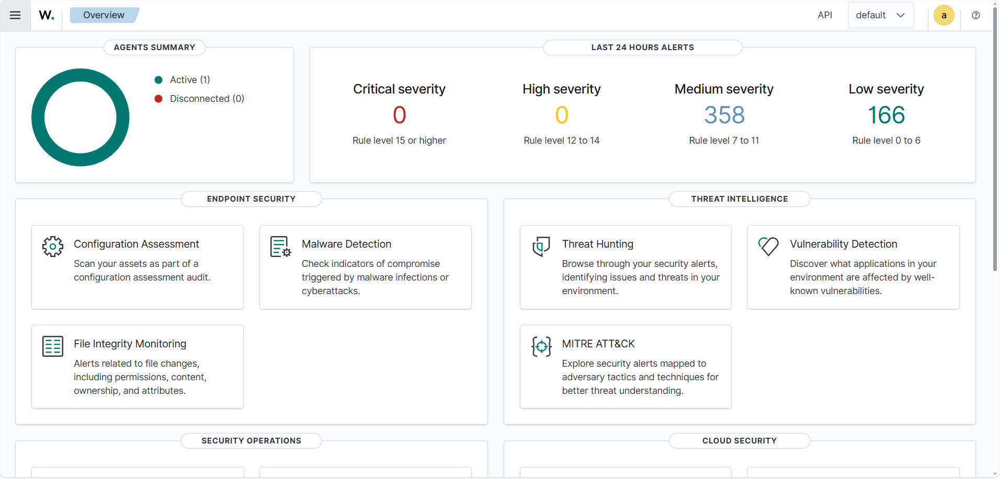
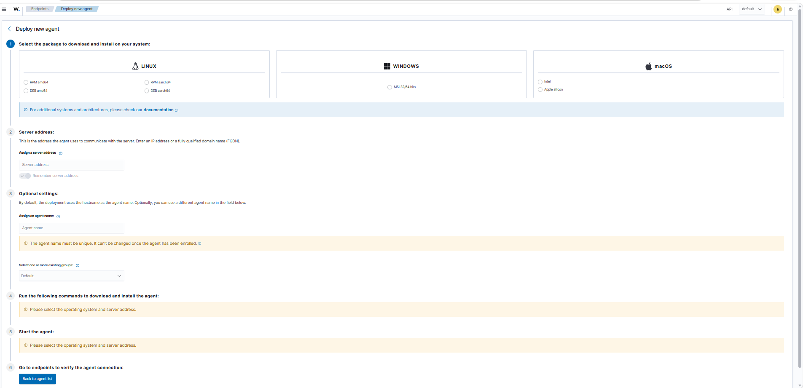
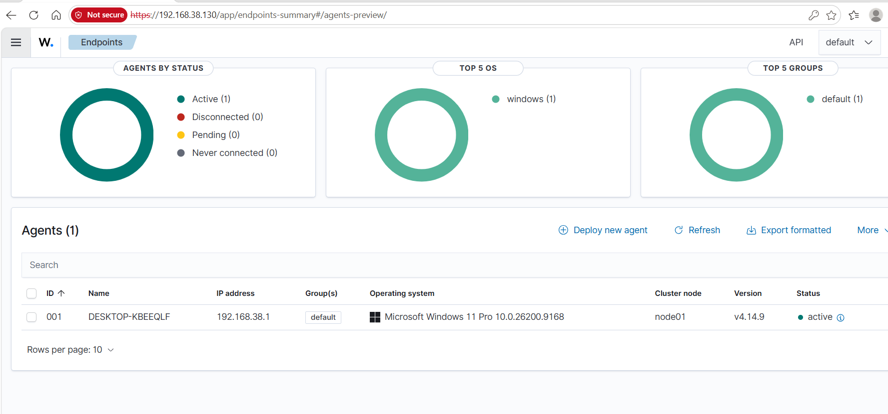
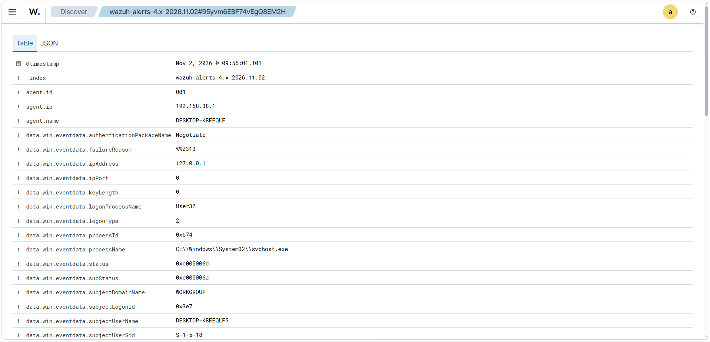
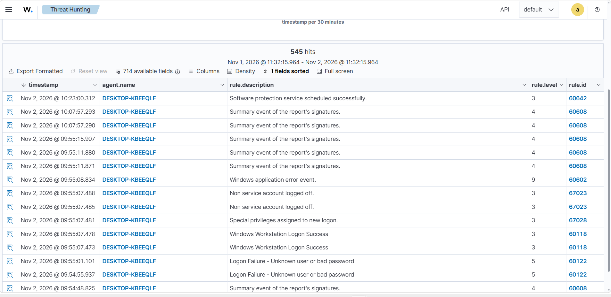

# Build a SIEM Home Lab (Wazuh SIEM & Log Monitoring)

Welcome to this cybersecurity portfolio project. This lab demonstrates the deployment of a centralized Security Operations Center (SOC) home lab using Wazuh SIEM, endpoint agent integration, brute-force attack simulation, and incident triage.

---

## 🛠️ Tools & Environment Used
* **SIEM Platform:** Wazuh (Dashboard & Manager)
* **Target Endpoint:** Windows Endpoint

---

## 📋 Lab Tasks & Implementation

### Task 1: Install Wazuh Server
Deployed and configured the core Wazuh SIEM server and dashboard interface to establish a centralized security monitoring station.
* **Evidence:**
  * Wazuh Dashboard Overview: 
  * Agent Deployment Wizard: 

### Task 2: Connect Windows Endpoint
Deployed the Wazuh agent to the target Windows endpoint, establishing active, secure log ingestion and endpoint visibility.
* **Evidence:**

### Task 3: Generate Alerts (Brute-Force Simulation)
Simulated password brute-force and authentication failure scenarios (`Event ID 4625` / `Rule ID 60122`) to test rule triggers and log collection.
* **Evidence:**

### Task 4: Investigate Incidents
Performed SOC-level threat hunting and incident triage using the Wazuh dashboard to analyze security logs, track event timelines, and verify endpoint integrity.
* **Incident Summary:**
  * **Target Endpoint:** Windows Endpoint
  * **Event Type:** Windows Logon Failure / Authentication Brute-Force (`Rule ID: 60122`, `Event ID: 4625`)
  * **Findings:** Multiple failed logon attempts were tracked. Analysis confirmed that no subsequent successful logins occurred, verifying the attack did not compromise the host.
* **Evidence:**

---

## 💡 Key Skills Learned & Resume Highlights

* **SIEM Monitoring:** Configured and navigated Wazuh SIEM dashboards for real-time security event analysis.
* **Alert Investigation:** Triaged security rule triggers, analyzed event metadata, and conducted formal incident investigations.
* **Endpoint Visibility:** Streamlined log ingestion across Windows agents to maintain comprehensive host monitoring.

**Resume Bullet:**
> *Built and configured a Wazuh-based SIEM lab for centralized log collection and security monitoring, successfully detecting and investigating simulated authentication brute-force attacks.*
